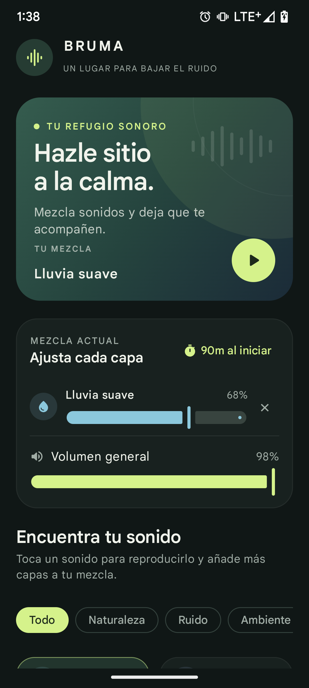

<a href="README.md">Español</a> · <a href="README.en.md">English</a> · <a href="README.de.md">Deutsch</a> · <a href="README.zh-CN.md">简体中文</a> · <a href="README.ru.md">Русский</a>

# Bruma

Bruma ist eine kostenlose Open-Source-App für Android. Sie spielt Umgebungsgeräusche im Hintergrund ab und begleitet so Musik aus anderen Apps.

**Keine Werbung. Kein AI-Slop. Eine einfache, optimierte App für den Alltag.**

Bruma entstand aus einer persönlichen Frustration: Ich fand keine einfache, kostenlose und werbefreie Android-App, die Hintergrundgeräusche mit meiner Musik mischt. Also habe ich eine entwickelt und teile den Quellcode, damit alle sie nutzen und Beiträge beisteuern können. Der Name erinnert an leichten Nebel: ein Hintergrund, der begleitet, ohne sich aufzudrängen.

Die Benutzeroberfläche ist auf Spanisch, Englisch, Deutsch, vereinfachtem Chinesisch und Russisch verfügbar. Sie folgt der Gerätesprache; ab Android 13 lässt sich Brumas Sprache auch in den Systemeinstellungen auswählen.

## Download

**Aktuelle Version: 1.0.12.** Das verfügbare APK ist eine Debug-Version zum Testen und keine für die Veröffentlichung signierte Version.

[Bruma 1.0.12 herunterladen (Debug-APK)](https://github.com/vicentolabs/bruma-sounds-opensource/releases/tag/v1.0.12-debug)

## Funktionen

- 21 lokal gespeicherte Aufnahmen: Regen, Sturm, zwei Feuer, Fluss, Ozean, Wind, Schneesturm, Ventilatoren, Dunstabzüge, Klimaanlage, Rechenzentrum, Flugzeugkabine, Autofahrt, Regen im Auto sowie braunes, rosa, weißes und graues Rauschen.
- Mehrere Klänge mischen, jede Ebene einzeln regeln und die Gesamtlautstärke anpassen.
- Wiedergabe im Hintergrund mit Benachrichtigungssteuerung und Timer mit sanftem Ausblenden.
- Favoriten auf dem Gerät, Kategorienfilter, Offline-Wiedergabe und sieben fertige Klangwelten.
- Für die Wiedergabe der Aufnahmen ist keine Internetverbindung nötig.

## Mitmachen

Bruma wird geteilt, damit alle die App nutzen, den Quellcode ansehen und sie verbessern können. Melde Fehler oder schlage Ideen über ein Issue vor oder sende einen Pull Request. Auch Hilfe beim Prüfen der Übersetzungen ist willkommen.

## Audio und Lizenzen

Die Aufnahmen liegen für die Offline-Wiedergabe in `app/src/main/assets/audio/`. Die App synthetisiert sie nicht. Quellen stehen in `AUDIO_CREDITS.md` und unter **Audioquellen und Lizenzen** in der App. Die Aufnahmen sind CC0-lizenziert, der Quellcode steht unter MIT.

Bruma fordert keinen Android-Audiofokus an und kann deshalb parallel zu Musik oder Videos anderer Apps laufen. Ob die gleichzeitige Wiedergabe funktioniert, hängt vom Gerät und der Android-Version ab.

## Kompilieren

1. Projekt in Android Studio öffnen.
2. Bei Bedarf Android SDK 35 und JDK 17 installieren.
3. Gradle synchronisieren und die Konfiguration `app` auf Android 8.0 (API 26) oder neuer starten.

Ein Debug-APK lässt sich mit `gradlew.bat :app:assembleDebug` unter Windows oder `./gradlew :app:assembleDebug` unter macOS/Linux erstellen.
