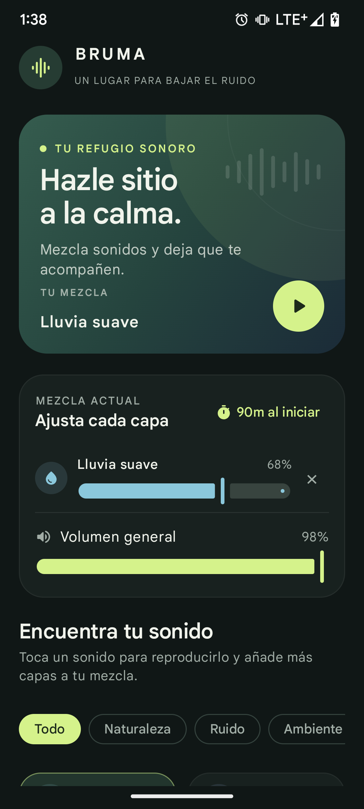

<a href="README.md">Español</a> · <a href="README.en.md">English</a> · <a href="README.de.md">Deutsch</a> · <a href="README.zh-CN.md">简体中文</a> · <a href="README.ru.md">Русский</a>

# Bruma

Bruma is a free and open-source Android app for playing ambient background sounds alongside music from other apps.

**No ads. No AI slop. A simple, optimized app made to be used.**

Bruma started with a personal frustration: I could not find a simple, free, ad-free Android app for listening to background sounds with my music. I made one and share its source so anyone can use it and contribute. The name evokes a light mist: a background that stays with you without taking over.

The interface is available in Spanish, English, German, Simplified Chinese, and Russian. It follows the device language; on Android 13 and newer, you can also choose Bruma's language in system settings.

## Download

**Current version: 1.0.12.** The available APK is a debug build for testing, not a production-signed release.

[Download Bruma 1.0.12 (debug APK)](https://github.com/vicentolabs/bruma-sounds-opensource/releases/tag/v1.0.12-debug)

## Features

- 21 local recordings: rain, storms, two fires, river, ocean, wind, blizzard, fans, kitchen extractors, air conditioning, data center, aircraft cabin, driving, rain in a car, and brown, pink, white, and grey noise.
- Mix multiple sounds, with independent volume for each layer and a master volume control.
- Background playback with notification controls and a timer with gradual fade-out.
- On-device favorites, category filters, offline playback, and seven quick scenes.
- The app does not need an Internet connection to play its recordings.

## Contributing

Bruma is shared so people can use it, study the source, and improve it. Open an issue to report a problem or suggest an idea, or send a pull request. Help reviewing translations is welcome too.

## Audio and licenses

Recordings are bundled in `app/src/main/assets/audio/` for offline playback. They are not synthesized by the app. The sources are listed in `AUDIO_CREDITS.md` and in **Audio sources and licenses** in the app. The recordings are CC0; the source code is MIT-licensed.

Playback does not request Android audio focus, so Bruma can play alongside music or video in other apps. Simultaneous playback may vary by device and Android version.

## Build

1. Open the project in Android Studio.
2. Install Android SDK 35 and JDK 17 if prompted.
3. Sync Gradle and run the `app` configuration on Android 8.0 (API 26) or newer.

To build a debug APK from the command line, run `gradlew.bat :app:assembleDebug` on Windows or `./gradlew :app:assembleDebug` on macOS/Linux.
