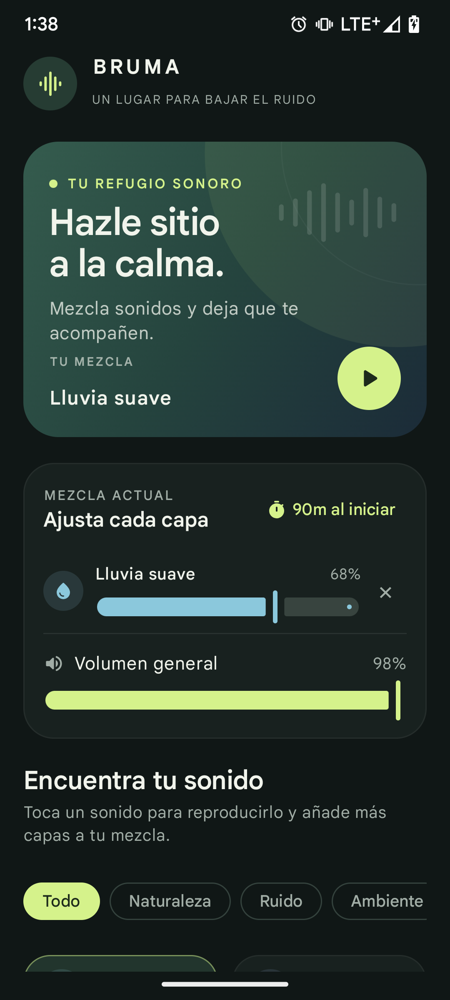

  

<h1 align="center">Bruma</h1>

Aplicación Android gratuita y de código abierto para escuchar y mezclar sonidos ambientales.

<strong>Sin publicidad ni AI slop.</strong> Una app sencilla, optimizada y hecha para usar.

  

Bruma toma su nombre de esa neblina ligera que crea un ambiente tranquilo sin imponerse. El proyecto se comparte para que cualquiera pueda usarlo, estudiar cómo está hecho y, si le apetece, contribuir.

## Incluye

- 21 grabaciones locales: lluvia, tormenta, dos fuegos, río, océano, viento, ventisca, ventiladores, extractor de cocina (normal y fijo), aire acondicionado, centro de datos, cabina de avión, conducción, lluvia en coche y ruidos marrón, rosa, blanco y gris.
- Mezcla de varios sonidos con volumen independiente y control general.
- Servicio Android de reproducción en primer plano, controles en la notificación y temporizador personalizable en horas y minutos con atenuación gradual.
- Favoritos guardados en el dispositivo, filtros por categoría y funcionamiento sin conexión.
- Siete escenas rápidas: vuelo nocturno, chimenea con lluvia, tormenta en el mar, lluvia en el coche, ventisca nocturna, conducción y centro de datos.

## Contribuir

Si te apetece colaborar, puedes abrir una issue para informar de un error o proponer una idea, o enviar un pull request. Las preguntas y aportaciones de cualquier tamaño son bienvenidas.

## Audio y referencias

Las grabaciones están descargadas y empaquetadas en `app/src/main/assets/audio/`; la app no sintetiza los efectos ni necesita conexión para reproducirlos. Proceden de BigSoundBank y Freesound, con licencias CC0. El detalle de cada fuente está en `AUDIO_CREDITS.md` y en **Fuentes y licencias** dentro de la app. No se extrae ni redistribuye audio de los vídeos de YouTube.

La reproducción no solicita el foco de audio de Android para permitir que la mezcla suene junto a música o vídeos de otras apps, incluido YouTube. El comportamiento simultáneo puede variar según el fabricante y la versión de Android.

## Abrir y compilar

1. Abre esta carpeta en Android Studio.
2. Instala el SDK de Android 35 y un JDK 17 si Android Studio lo solicita.
3. Sincroniza Gradle y ejecuta la configuración `app` en un dispositivo o emulador Android 8.0 (API 26) o posterior.

También puedes generar el APK de depuración con `gradlew.bat :app:assembleDebug` desde Windows.

El permiso de notificaciones se solicita al iniciar la reproducción en Android 13 o posterior. La app necesita una notificación activa para mantener el servicio de audio en segundo plano.
