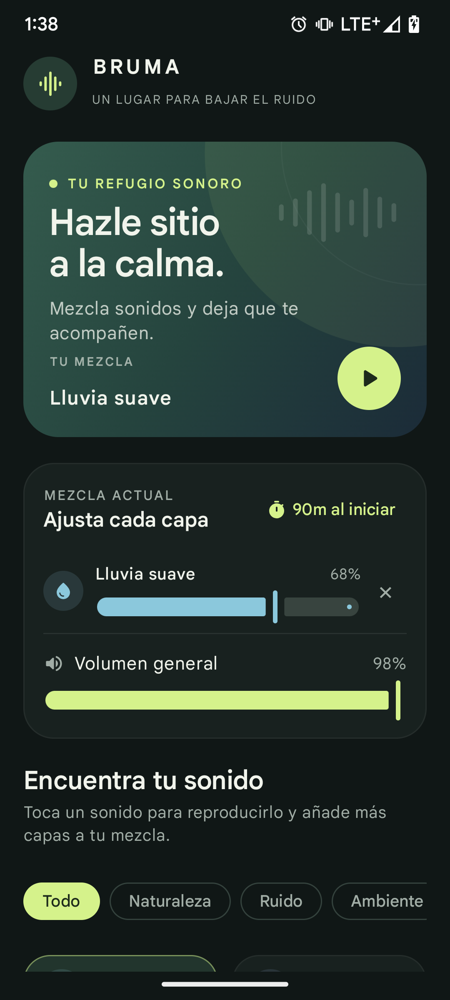

<a href="README.md">Español</a> · <a href="README.en.md">English</a> · <a href="README.de.md">Deutsch</a> · <a href="README.zh-CN.md">简体中文</a> · <a href="README.ru.md">Русский</a>

# Bruma

Bruma — бесплатное приложение с открытым исходным кодом для Android. Оно воспроизводит фоновые звуки и помогает слушать музыку из других приложений.

**Без рекламы и AI-слопа. Простое, оптимизированное приложение для повседневного использования.**

Bruma появилась из личной потребности: я устал искать простое бесплатное приложение без рекламы, которое добавляло бы фоновые звуки к моей музыке. Подходящего варианта не нашлось, поэтому я создал Bruma и публикую исходный код, чтобы каждый мог пользоваться приложением и вносить свой вклад. Название напоминает о лёгком тумане: он создаёт фон и не отвлекает на себя.

Интерфейс доступен на испанском, английском, немецком, упрощённом китайском и русском языках. Приложение использует язык устройства; начиная с Android 13 язык Bruma можно выбрать отдельно в системных настройках.

## Скачать

**Текущая версия: 1.0.12.** Доступный APK — отладочная сборка для тестирования, а не релиз, подписанный ключом публикации.

[Скачать Bruma 1.0.12 (debug APK)](https://github.com/vicentolabs/bruma-sounds-opensource/releases/tag/v1.0.12-debug)

## Возможности

- 21 локальная запись: дождь, гроза, два вида огня, река, океан, ветер, метель, вентиляторы, кухонные вытяжки, кондиционер, центр обработки данных, салон самолёта, поездка на машине, дождь в машине, а также коричневый, розовый, белый и серый шум.
- Смешивание нескольких звуков, отдельная громкость каждого слоя и общая регулировка громкости.
- Фоновое воспроизведение с управлением из уведомления и таймером с плавным затуханием.
- Избранное на устройстве, фильтры по категориям, офлайн-воспроизведение и семь готовых сцен.
- Для воспроизведения записей подключение к интернету не требуется.

## Участие в проекте

Bruma публикуется бесплатно и с открытым кодом, чтобы каждый мог пользоваться приложением, изучать исходники и помогать его улучшать. Сообщайте об ошибках и предлагайте идеи в issues или отправляйте pull request. Помощь с проверкой переводов тоже приветствуется.

## Аудио и лицензии

Записи хранятся в `app/src/main/assets/audio/` и доступны офлайн. Приложение не синтезирует эти звуки. Источники перечислены в `AUDIO_CREDITS.md` и в разделе **Источники аудио и лицензии** в приложении. Записи распространяются по CC0, исходный код — по MIT.

Bruma не запрашивает аудиофокус Android, поэтому может воспроизводить звуки одновременно с музыкой или видео из других приложений. Одновременное воспроизведение зависит от устройства и версии Android.

## Сборка

1. Откройте проект в Android Studio.
2. При необходимости установите Android SDK 35 и JDK 17.
3. Синхронизируйте Gradle и запустите конфигурацию `app` на устройстве или эмуляторе с Android 8.0 (API 26) или новее.

Для сборки отладочного APK выполните `gradlew.bat :app:assembleDebug` в Windows или `./gradlew :app:assembleDebug` в macOS/Linux.
