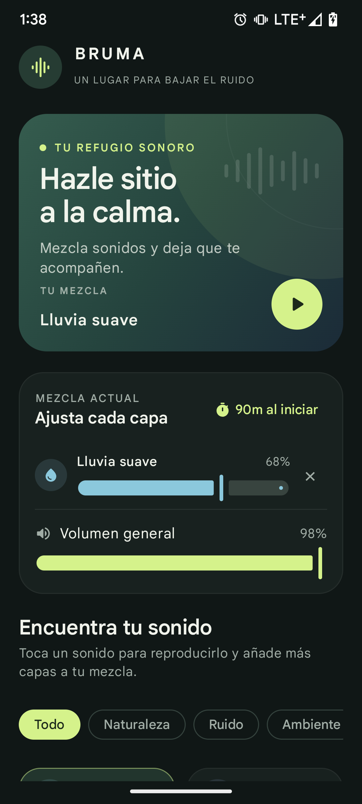

<a href="README.md">Español</a> · <a href="README.en.md">English</a> · <a href="README.de.md">Deutsch</a> · <a href="README.zh-CN.md">简体中文</a> · <a href="README.ru.md">Русский</a>

# Bruma

Bruma 是一款免费的 Android 开源应用，可以在后台播放环境声音，陪伴你在其他应用中收听的音乐。

**没有广告，不堆砌 AI 垃圾内容。简单、轻量，专注于好好使用。**

Bruma 源于一个个人需求：我一直想找一款简单、免费、无广告的 Android 应用，让环境声音陪伴我的音乐，却始终没有找到合适的选择。于是我做了 Bruma，并公开源代码，让任何人都能使用和参与改进。名字 Bruma 让人想到轻柔的薄雾：安静陪伴，不喧宾夺主。

界面支持西班牙语、英语、德语、简体中文和俄语。应用默认跟随系统语言；Android 13 及更高版本也可以在系统设置中单独选择 Bruma 的语言。

## 下载

**当前版本：1.0.12。**目前提供的是用于测试的 debug APK，并非正式发布签名版本。

[下载 Bruma 1.0.12（debug APK）](https://github.com/vicentolabs/bruma-sounds-opensource/releases/tag/v1.0.12-debug)

## 功能

- 21 段本地录音：雨声、风暴、两种火焰、河流、海洋、风、暴风雪、风扇、厨房抽油烟机、空调、数据中心、飞机客舱、驾车、车内雨声，以及棕色、粉红、白色和灰色噪音。
- 混合多个声音，分别调节每一层的音量，并控制总音量。
- 后台播放、通知栏控制，以及带渐弱效果的定时器。
- 本地收藏、分类筛选、离线播放和七种快捷场景。
- 播放录音不需要联网。

## 参与贡献

Bruma 以免费开源的方式分享，欢迎大家使用、阅读代码并一起改进。可以提交 issue 报告问题或提出想法，也可以发送 pull request。欢迎帮助检查和完善翻译。

## 音频与许可

录音保存在 `app/src/main/assets/audio/`，可离线播放，应用不会合成这些声音。来源见 `AUDIO_CREDITS.md` 和应用内的**音频来源与许可**。录音采用 CC0 许可，源代码采用 MIT 许可。

Bruma 不申请 Android 音频焦点，因此可以与其他应用中的音乐或视频同时播放。具体表现可能因设备和 Android 版本而异。

## 构建

1. 在 Android Studio 中打开项目。
2. 如有提示，安装 Android SDK 35 和 JDK 17。
3. 同步 Gradle，在 Android 8.0（API 26）或更高版本的设备或模拟器上运行 `app` 配置。

在 Windows 上运行 `gradlew.bat :app:assembleDebug`，或在 macOS/Linux 上运行 `./gradlew :app:assembleDebug`，即可构建 debug APK。
